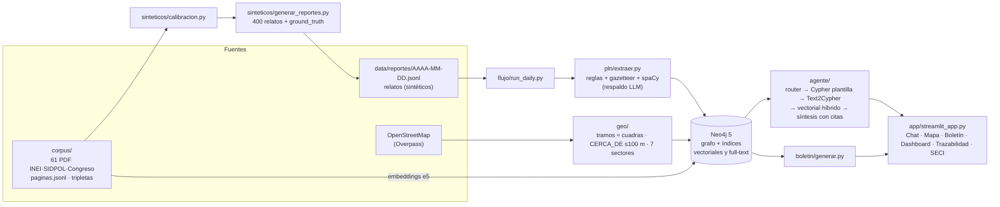

# Memoria Vial Segura — Grafo, flujo diario y agente GraphRAG (piezas 4 y 5)

Base de conocimiento delictivo **a nivel de calle** del distrito de **Los Olivos (Lima)**. Cada día los
reportes nuevos pasan por PLN, actualizan un grafo Neo4j en el que **cada hecho guarda su fuente**, y se
genera un boletín para el turno siguiente. Un agente GraphRAG responde preguntas **citando el reporte de
origen** (`[R-000123]`) o la página oficial (`[INEI-8556475 p.19]`).

> ⚠️ **Datos sintéticos — prototipo TRL 4.** La red vial y los puntos de interés son reales (OpenStreetMap).
> Los 400 reportes son simulados y están calibrados con cifras agregadas INEI/SIDPOL. No hay datos de
> personas (Ley 29733): solo incidentes y patrones.

Curso Gestión del Conocimiento · FISI–UNMSM · 2026-II.

---

## Cómo correrlo (Windows, PowerShell) en 5 comandos

Requisitos: Python 3.11, Docker Desktop encendido.

```powershell
cd C:\2026-2\GestionDelConocimiento\Proyecto\memoria-vial
py -3.11 -m venv .venv; .\.venv\Scripts\Activate.ps1                           # 1. entorno
pip install -r requirements.txt; python -m spacy download es_core_news_sm      # 2. dependencias
copy .env.example .env; docker compose up -d                                   # 3. Neo4j 5 + APOC (edita la clave en .env)
python preparar.py                                                              # 4. OSM → sintéticos → grafo → backfill → evaluación (~3 min)
streamlit run app/streamlit_app.py                                              # 5. demo en http://localhost:8501
```

- Neo4j Browser: http://localhost:7474 (usuario y clave de `.env`).
- **Sin Docker:** instala Neo4j Desktop (o crea una instancia gratuita en Neo4j AuraDB), instala APOC y pon su
  `NEO4J_URI`, `NEO4J_USER` y `NEO4J_PASSWORD` en `.env`. El resto no cambia.
- **LLM opcional:** con `ANTHROPIC_API_KEY` en `.env`, el agente usa Claude (`LLM_MODEL`, por defecto
  `claude-opus-5-5`) para el router, Text2Cypher y la redacción. **Sin clave todo funciona** con router por
  reglas, consultas plantilla y respuestas por plantilla. Los embeddings siempre son locales
  (`intfloat/multilingual-e5-small`).
- Linux/macOS: igual, con `python3.11 -m venv .venv && source .venv/bin/activate`.

### Despliegue en la nube (Streamlit Community Cloud + Neo4j AuraDB Free)

1. **AuraDB**: en https://console.neo4j.io crea una instancia *AuraDB Free* y guarda la URI
   (`neo4j+s://….databases.neo4j.io`), el usuario y la clave.
2. **Cargar el grafo en Aura** desde tu PC: pon esos tres valores en `.env` (`NEO4J_URI`, `NEO4J_USER`,
   `NEO4J_PASSWORD`) y ejecuta `python preparar.py`. Usa la caché de OSM y la misma semilla, así que el
   resultado es idéntico al local.
3. **Streamlit Cloud**: en https://share.streamlit.io elige *Create app*, el repositorio y la rama `main`, y
   el archivo principal `app/streamlit_app.py`. En *Advanced settings* elige Python 3.11 y, en **Secrets**,
   pega el contenido de `.streamlit/secrets.toml.example` con tus valores de Aura.
4. La primera instalación tarda unos minutos (torch CPU y spaCy). Para volver a la versión local, restaura
   en `.env` la URI `bolt://localhost:7687`.

### Comandos sueltos

| Qué | Comando |
|---|---|
| Flujo de un día | `python flujo/run_daily.py --fecha 2026-10-20` |
| Backfill | `python flujo/run_daily.py --desde 2026-08-01 --hasta 2026-10-20` |
| Demo en clase: volver al 13-oct y avanzar 3 días | `python flujo/run_daily.py --revertir-a 2026-10-13 --simular-dias 3` |
| Programar ejecución diaria (Programador de tareas) | `.\flujo\programar_tarea.ps1 -Hora "06:00"` |
| Preguntar al agente desde la terminal | `python agente/agente.py "¿Qué modalidades nuevas aparecieron esta semana?"` |
| Boletín | `python boletin/generar.py --fecha 2026-10-20` → `data/boletines/` (MD + HTML) |
| Pruebas | `python -m pytest` |
| Evaluaciones | `python pln/evaluar.py` · `python eval/run_eval.py` → `reports/` |
| Ontología OWL | `python ontologia/exportar_ttl.py` → `ontologia/memoria_vial.ttl` |

---

## Arquitectura



Esquema del grafo: [docs/esquema_grafo.md](docs/esquema_grafo.md) · Cypher: [grafo/esquema.cypher](grafo/esquema.cypher) ·
OWL: [ontologia/memoria_vial.ttl](ontologia/memoria_vial.ttl) · Mapeo ICCS: [ontologia/mapeo_iccs.csv](ontologia/mapeo_iccs.csv)

**Grafo cargado:** 3 346 Tramos · 768 PuntosInteres · 7 605 `CERCA_DE` · 7 Sectores · 400 Incidentes/Reportes ·
13 Modalidades · 7 Intervenciones · 61 Documentos · 1 470 Páginas con embedding · 137 filas de tabla de Los Olivos ·
81 Corridas.

### Estructura

```
memoria-vial/
├─ config.py · llm.py · preparar.py · docker-compose.yml · .env.example · requirements.txt
├─ geo/            descargar_osm.py (Overpass + caché) · construir_tramos.py
├─ sinteticos/     generar_reportes.py · calibracion.py · CALIBRACION.md
├─ pln/            gazetteer.py · extraer.py (interfaz Extractor) · evaluar.py
├─ grafo/          esquema.cypher · cargar.py · conexion.py · embeddings.py
├─ flujo/          run_daily.py · programar_tarea.ps1
├─ agente/         parametros.py (router) · consultas.py (plantillas) · text2cypher.py · vectorial.py · sintesis.py · agente.py
├─ boletin/        generar.py
├─ app/            streamlit_app.py
├─ ontologia/      catalogos.py · exportar_ttl.py · memoria_vial.ttl · mapeo_iccs.csv
├─ eval/           preguntas.yaml · run_eval.py · rag_simple.py
├─ tests/          pytest (idempotencia, guardas Text2Cypher, preguntas plantadas, PLN, privacidad)
├─ docs/ · reports/ · data/ (geo, reportes, extraidos, boletines, ground_truth.json, intervenciones.csv)
```

---

## Cómo responde el agente

1. **Router**: clasifica la pregunta en patrón, intervención, emergente, contexto, conteo, libre, privacidad
   o fuera de alcance, y extrae parámetros (modalidad, medio, horas, fechas, tipo de POI, sector, vía). Primero
   por reglas; si hay LLM, este solo **rellena** parámetros faltantes (JSON validado con Pydantic).
2. **Cypher plantilla parametrizado** para las 3 preguntas de la diapositiva 5 (`agente/consultas.py`).
3. **Text2Cypher** de respaldo (requiere LLM), con tres barreras: una regex que rechaza
   `CREATE|MERGE|DELETE|SET|REMOVE|DROP|FOREACH|LOAD CSV`, procedimientos APOC y varias sentencias;
   `LIMIT` forzado (≤ 200); y ejecución en una **transacción de solo lectura**. Si Neo4j devuelve error,
   reintenta pasándole el error al LLM.
4. **Búsqueda híbrida** en páginas oficiales: índice vectorial más índice full-text (Lucene, español),
   fusionados por RRF. Por defecto usa la **edición vigente** de cada serie, y filtra por institución si la
   pregunta la nombra. Para preguntas libres usa relatos similares.
5. **Síntesis** con citas obligatorias. Con LLM se verifica que **cada cita exista en la evidencia**; si no,
   se usa la plantilla. La UI muestra la tabla de evidencia y el Cypher ejecutado. En la pregunta 2 se
   comparan 4 semanas antes y 4 después por tramo, con la advertencia de que es descriptivo, no causal.

---

## Resultados

### PLN (`reports/eval_pln.md`) — meta ≥ 85 % en vía y modalidad

| Vía | Cuadra | Hora | Modalidad | Medio | Punto ref. | Tramo |
|---|---|---|---|---|---|---|
| **97,8 %** | 97,0 % | 100 % | **100 %** | 100 % | 100 % | 96,0 % |

Los fallos de tramo se concentran en relatos sin vía o sin cuadra, y en calles homónimas de OSM. En esos
casos el extractor marca `tramo_resuelto=false` en lugar de adivinar.

### GraphRAG (`reports/eval_graphrag.md`) — 15 preguntas

| Métrica | Valor |
|---|---|
| Respuestas correctas | **15/15** (3 de la diapositiva + 6 variantes + 3 de contexto + 1 conteo + 2 fuera de alcance/privacidad) |
| Respuestas con ≥ 1 cita válida | **100 %** (todas las citas existen en el grafo) |
| Latencia mediana | < 0,2 s sin LLM |
| **GraphRAG vs. RAG vectorial simple** (9 preguntas multi-salto) | **9/9 vs. 0/9** |

El RAG vectorial falla porque las respuestas dependen de **relaciones**: cercanía a un paradero
(`CERCA_DE`), tramos intervenidos (`APLICADA_EN`) con conteos en ventanas de tiempo, y ausencia de registros
en los 30 días previos. Ninguna de esas cosas aparece en el texto de los k relatos más parecidos.

> Sesgo declarado: las preguntas y las reglas del router las escribió el mismo equipo, y los relatos salen
> de plantillas. El 100 % es una **prueba de regresión**, no una medida de generalización.

### Pruebas

`python -m pytest` → **27 pruebas**: idempotencia (carga base y flujo diario dos veces, mismos conteos),
12 ataques de escritura rechazados por Text2Cypher más la barrera de la transacción de lectura, las 3
preguntas contra `ground_truth.json`, la meta del PLN y la ausencia de datos personales en los relatos.

---

## Decisiones y supuestos

| Tema | Decisión |
|---|---|
| Red vial | Overpass API sobre la relación OSM 1944759 (ubigeo 150117). Vías con nombre `residential` o superiores. Caché en `data/geo/*.overpass.json`. Si Overpass falla, el script imprime la consulta y las instrucciones para descargarla a mano; **no inventa la red**. |
| Tramos | ~100 m a lo largo de la vía (`AV_UNIVERSITARIA_C08`), numerados desde el extremo oeste/sur. Las dobles calzadas paralelas (<110 m) se cuentan una sola vez. Las vías homónimas en OSM reciben un sufijo (`_2`). Es una aproximación a la numeración municipal de cuadras. |
| POIs | Paraderos (`bus_stop`, `platform`), mercados y supermercados, colegios, parques y bancos. `CERCA_DE` si están a ≤ 100 m (UTM 18S). |
| Sectores | **Ficticios**: k-means (k = 7, semilla fija) sobre centroides de tramos, numerados de norte a sur y nombrados por su avenida principal. |
| Calibración | Proporciones de modalidad tomadas de **INEI-8556475 p.19** (Lima Metropolitana y Callao, feb–jul 2026), verificadas automáticamente contra el texto de la página. Los repartos internos y el perfil horario son supuestos documentados en [sinteticos/CALIBRACION.md](sinteticos/CALIBRACION.md). |
| Patrones plantados | P1: clúster de robo de celular desde moto (18–20 h) junto a paraderos de 3 avenidas en la última semana. P2: patrullaje reforzado (7 set – 4 oct) en 5 tramos, 4 bajan y 1 no. P3: bujiazo y marcaje solo en la última semana, en vías sin registros en 30 días. |
| ICCS | Una modalidad local se mapea a un código ICCS (UNODC). La clave de `Modalidad` es `id` porque varias modalidades comparten código (04011 robo a la persona). Nota: **0501 en ICCS es "burglary" (allanamiento), no robo**, por eso robo usa 0401x. |
| Procedencia | `(:Incidente)-[:DERIVADO_DE]->(:Fuente:Reporte)` (`prov:wasDerivedFrom`). Las intervenciones derivan de un `(:Fuente)` "plan operativo" sintético. |
| Idempotencia | Todo `MERGE` por id. Las relaciones producidas por el PLN (`TIPO`, `USA`, `OCURRE_EN`) se rehacen en cada corrida para que una re-ejecución corrija sin duplicar. Los embeddings ya calculados no se recalculan. |
| Capa estadística | `paginas.jsonl` → `Documento`/`Pagina` con embedding. Del `tripletas_extraidas.json` de la pieza 3 (que **no se modificó**) se cargan solo las 137 filas no vacías que mencionan Los Olivos, ligadas a su página. |
| Pieza 3 | `pln/extraer.py` define la interfaz `Extractor.extraer(texto) -> IncidenteExtraido`. Para enchufar otro extractor: `EXTRACTOR=modulo:Clase` en `.env`. |
| Privacidad | Los relatos nunca llevan nombres, DNI, placas ni rasgos (hay un test que lo verifica). El agente rechaza pedidos de datos personales (Ley 29733). |

## Limitaciones

- Los relatos son **sintéticos y de plantilla**: el PLN por reglas está ajustado a ese vocabulario. Con
  partes reales de serenazgo la precisión bajará; para eso están el respaldo LLM y la interfaz `Extractor`.
- La numeración de cuadras es aproximada (segmentos de 100 m), no la catastral.
- Sectores de patrullaje ficticios; no corresponden a la sectorización real de la municipalidad.
- La búsqueda de contexto es buena para preguntas con términos del informe ("victimización", "robo de
  vehículos", "extorsión") y más débil para preguntas muy genéricas.
- Sin LLM, Text2Cypher no está disponible: las preguntas fuera de las plantillas reciben relatos similares.
- La comparación antes/después de intervenciones es **descriptiva, no causal** (sin grupo de control).
- Boletín en Markdown y HTML; el PDF se obtiene imprimiendo el HTML desde el navegador.

## Guion sugerido para la demo

1. `python flujo/run_daily.py --revertir-a 2026-10-13` y abrir la app.
2. **Boletín** → "Ejecutar ciclo diario" varias veces: el clúster nocturno de robo de celular aparece en los
   tramos calientes.
3. **Chat** → los 3 botones de la diapositiva 5. Abrir "Cypher ejecutado" y elegir una cita para ver el relato
   original (**Trazabilidad**).
4. **Mapa** → filtrar por robo de celular + moto + noche.
5. **Dashboard** → gráfico antes/después del patrullaje y calidad del PLN.
6. **SECI** → cerrar con el ciclo de conocimiento.
