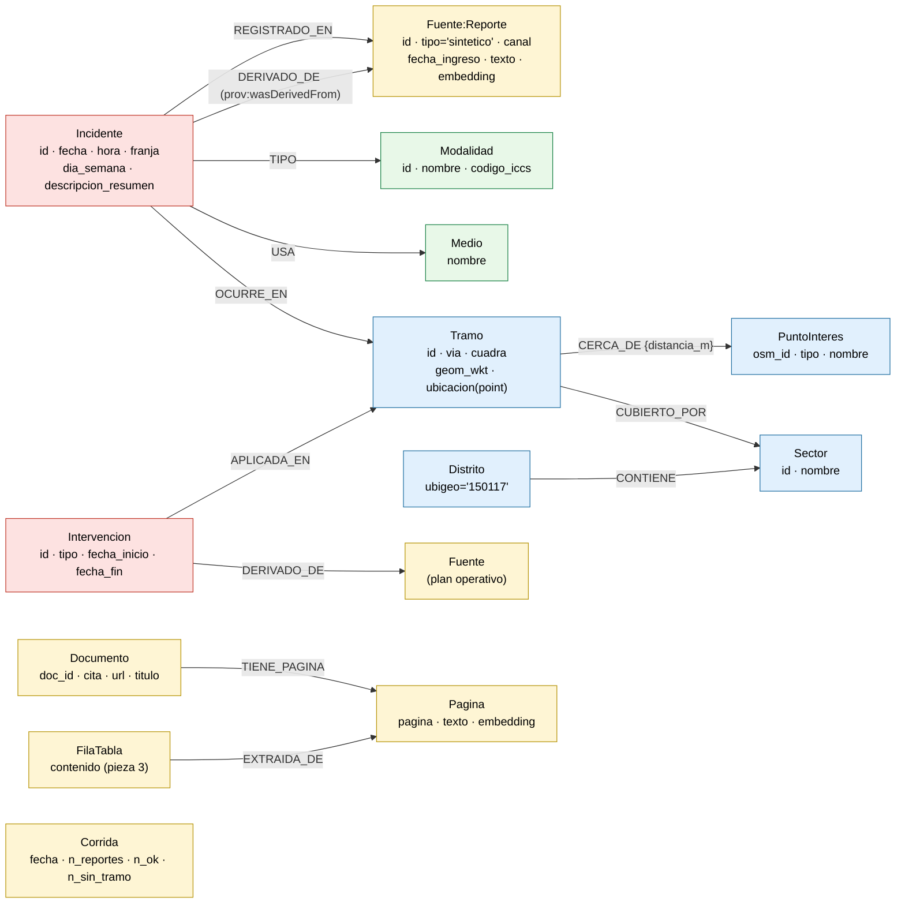

# Esquema del grafo — Memoria Vial Segura

Se renderiza en GitHub, VS Code (extensión Mermaid) o en https://mermaid.live.

**Capas**

- Rojo: hechos (incidentes, intervenciones). Azul: geografía real de OpenStreetMap (GeoSPARQL: WKT).
- Amarillo: procedencia (PROV-O): toda afirmación remonta a un `Reporte` o a una `Pagina` oficial.
- Verde: vocabularios controlados (modalidades mapeadas a ICCS de UNODC, medios).

**Índices**: unicidad en cada identificador, `POINT INDEX` en `Tramo.ubicacion` y
`PuntoInteres.ubicacion`, `VECTOR INDEX` (384 dim, coseno) en `Pagina.embedding` y
`Reporte.embedding`. Ver `grafo/esquema.cypher`. Equivalente OWL: `ontologia/memoria_vial.ttl`.
